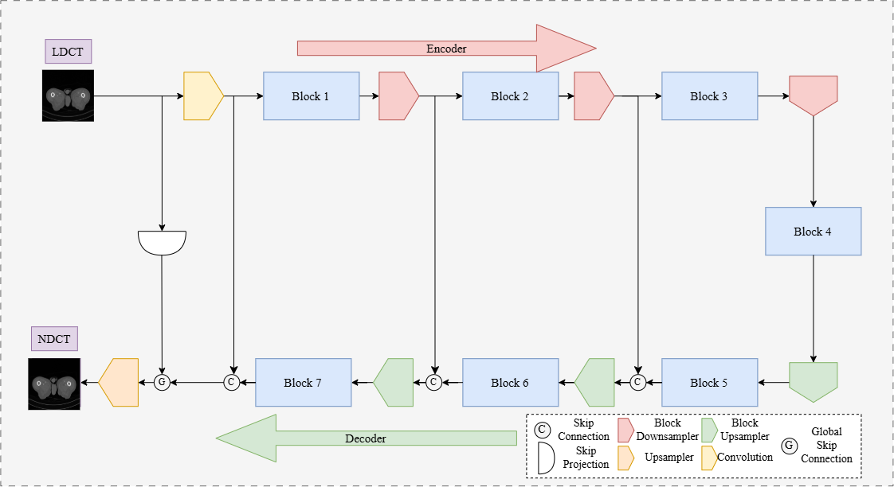

# RL_LDCT: Reinforcement Learning-Based Operator Selection For Low-Dose CT Denoising
Official PyTorch implementation of the paper **RL-LDCT: Reinforcement Learning-Based Operator Selection for Low-Dose CT Denoising**
## Overview
This repository contains the code to reproduce the deep learning model framework for LDCT denoising. By integrating Reinforcement learning, the agent discovered multiple optimal sequences of heterogeneous operators (Res-Net, Transformers, State-Space/Mamba, GNN, ConvLSTM). Used the `NAS_SR_Model` found in the [SRIQL: Implicit Q Learning for Ultralight-weight Image Super Resolution](https://github.com/mhadiniknam/SRIQL/blob/main/model.py) GitHub repository, modified the block operators, and integrated a learning rate scheduler. We used the 2016 AAPM Low Dose CT Grand Challenge Dataset with 8 patients used for training and 2 patients for validation and testing. 

## Files
- `blocks_2.py` & `model.py`: Define our search space operators and develop the suggested model architecture for the reinforcement learning model.
- `train.py`, `trainer.py` & `utils.py`: Define files used to train the reinforcement learning agent, generate the subsequent reward and evaluation metrics (PSNR & SSIM) using patch training.
- `dataset.py`: Loads our dataset for DICOM image slices (.dcm) or min-max normalized Hu saved npy array files.
- `dl_model_design.py`: Trains our selected model variation independently from the RL model using no-crop validation and testing results.

## Procedure
To ensure consistent results found in our paper, please convert the data into NPY arrays using the `prep.py` file or similar code found in the [RED-CNN GitHub](https://github.com/SSinyu/RED-CNN/blob/master/prep.py) adjust the `train_root`, `val_root` and `test_root` found in lines 353-355 in [dl_model_design.py](https://github.com/KevinPham-BME-Prog/RL_LDCT/blob/main/dl_model_design.py)

